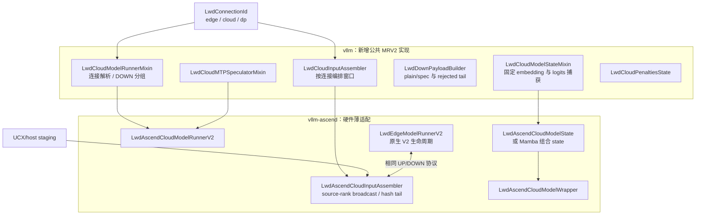

# LWD 适配 Model Runner V2：新主线迁移设计

> 状态：实现候选。代码已迁移到包含多边多云、UCX/host 数据面和原生 waiting queue 的新主线；聚焦 CPU UT 已覆盖核心路径，新主线 NPU ST 与 RFC 评审尚未完成。
>
> 迁移基线：`vllm` @ `368a7cc824`，`vllm-ascend` @ `12c01de23`。
> 旧实现仅作参考：旧分支的 Qwen3.6-27B 真机结果不能替代本主线验证。

## 1. 目标与范围

LWD 在同一发布物中按既有 `VLLM_USE_V2_MODEL_RUNNER` / `use_v2_model_runner()` 决议选择 V1 或 V2。边端负责 embedding 与采样结果回放，云端负责 decoder、采样和 rank 编码；V2 不改变这些业务语义。

本期目标：

- 新增 MRV2 的公共实现直接放在 vllm，避免以后再次上移；Ascend 只保留模型状态、TP/HCCL、hash 和 worker 接线。
- 保留新主线已有的多边多云、完整 `LwdConnectionId`、UCX/host staging、prefix refill、preemption rewind/skip 和原生 waiting queue，不回退为单边单云实现。
- V1 可继续运行；V2 不静默降级，engine、worker 和边云握手的版本必须一致。
- UP/DOWN 帧格式、连接内 seqno、arrival/W1/W2、host 生命周期和 DOWN rank-replay 协议保持不变。
- eager、PIECEWISE、FULL 使用同一套固定缓冲与输入语义；启动成功不等于图模式验证通过。

本期不做：

- 历史上移之外的新重构。V1 历史模块仅在复用边端执行逻辑、统一 worker 契约等必要位置调整，不把全部历史模块搬到上游。
- PCP/DCP、DBO、batch-sharded sampling、非标准 MTP 与 DSpark adaptive verification。相关配置先 fail-fast，后续按需求单独设计；PCP/DCP 是暂缓而非永久排除。
- structured output 的重新实现。新主线已经通过请求消息、云侧 grammar 初始化和边侧 grammar-ready 过滤恢复该能力，见 `lwd_structured_output_migration.md`；MRV2 复用原生采样 bitmask，不另建协议。

## 2. 新主线复核结论

| 项目 | 新主线事实 | 迁移决策 |
| --- | --- | --- |
| 多连接身份 | `LwdConnectionId(edge_id, cloud_id, dp_idx)` 是完整路由键 | UP inflight/watermark、窗口、DOWN payload 全部使用该对象，不能只存 `dp_idx` |
| 多云调度 | 请求 ID 含逻辑 edge 前缀，worker 持有本实例 `_lwd_connections` | runner 从请求解析 edge，再在本实例连接中找唯一路由；找不到或不唯一立即报错 |
| host/UCX | `_lwd_up_src_ranks` 按连接指定真实 endpoint；host stager 只存在于 endpoint rank | 不能再用 `prompt_stage is not None` 判断当前窗口的数据源，必须按连接比较 source rank 与本地 rank |
| DOWN 输出 | worker 已消费 `list[LwdDownPayload]` 和 `lwd_down_carriers` | V2 builder 输出带 connection 的 payload 列表，不恢复旧单载体字段 |
| ModelState | 上游 `resolve_model_state_cls()` 返回类；Ascend `init_asecnd_model_state()` 直接返回实例 | 两边分别适配，不能把旧 Ascend“返回类”的辅助接口照搬过来 |
| 原生队列 | 调度器使用 `waiting`、`kv_holding_waiting` 等原生队列 | 保留新主线调度逻辑，只补 W2 lookahead，不恢复旧等待队列 |
| structured output | 请求约束已上 wire，云侧显式 grammar init，边 picker 过滤未就绪请求 | 文档和代码均不得再写“LWD 尚未恢复 structured output” |

## 3. 总体架构

公共层不 import `torch_npu`、Ascend forward context 或具体 `LwdHostStager`。prompt stage 通过结构协议提供 host 行、到达数、消费位置和 rewind/skip；Ascend 子类处理 source-rank broadcast、hash expert tail 和固定 forward context。

## 4. 版本决议与启动边界

### 4.1 三层一致性

1. V1/V2 runner 声明实际 `runner_kind`，worker RPC 返回该值。
2. engine 启动控制面前收集全部 rank 的 runner 类型，要求唯一且与本地 V2 决议一致。
3. `LwdLinkHello` / `LwdLinkAccept` 携带带默认值的 `runner_kind`，双边拒绝不匹配。缺省按 V1 解读，兼容旧 V1；V2 不一致 fail-closed。

该字段只影响运行架构协商，不改变 UP/DOWN 数据格式。

### 4.2 启动校验

V2 在加载前拒绝非标准 MTP、DSpark adaptive verification、batch-sharded sampling、PCP/DCP>1 和 DBO。模型专用 state 先参与原生类型解析，再应用对应 LWD override；当前已组合通用 dense、通用 Mamba hybrid 和 DSV4.1 Engram state，未适配的专用 state 不因 LWD 被静默替换。

开启方式沿用现有 MRV2 开关，不新增 LWD 环境变量。运行时必须保证 engine 与所有 worker 使用同一套代码和同一开关。

## 5. Worker 与模型状态

### 5.1 云端

`LwdCloudWorker.init_device()` 在父类初始化前设置 `enable_prompt_embeds=True`，随后按缓存的 V2 决议构造 runner。数据面仍由 `LwdWorkerBase._init_lwd_data_plane()` 初始化，early recv、host stager 和 `_lwd_up_src_ranks` 使用新主线实现；V2 不恢复旧 HCCL 专用初始化路径。

`LwdCloudModelStateMixin`：

- 禁止把 meta prompt tensor 当作真实 embedding；
- 持有固定地址的 `remote_inputs_embeds` 和 `next_prompt_embeds`；
- 在请求增删时维护 M-RoPE、next-prompt 和 req-state；
- 通过 `compute_sample_logits()` 捕获同一次采样的 logits，数值计算仍委托模型。

通用 Mamba hybrid 使用 `LwdAscendCloudMambaHybridModelState`，dense 使用 `LwdAscendCloudModelState`，DSV4.1 eager 使用 `LwdAscendCloudEngramModelState`。模型自定义 state 先确定原生类型，再应用对应 LWD override。

### 5.2 正式社区接口

- `ModelState.compute_sample_logits()` 统一委托模型计算并调用 `capture_sample_logits()`。默认捕获为空实现，LWD 只覆写捕获方法；Ascend 在裁剪后再次通过同一接口捕获，不再探测 LWD 私有方法。
- `GPUModelRunner.create_model_state()` 和 `create_speculator()` 是组件选择接缝。LWD 通过“原生 state 类型到 LWD state 类型”的映射选择实现，模型显式提供的 state 始终优先，原生工厂不再判断 `lwd_config`。
- `AsyncModelRunnerOutput.get_model_runner_output()` 在不等待异步拷贝的情况下返回内部输出，worker 与 executor 共用该公开接口，不再保留 `_model_runner_output` 私有别名。EP fault 查询保持原生行为，不因 LWD 被跳过。

### 5.3 边端

边端不进入原生 decoder/sample 主流程，worker 直调 EMBED/UNEMBED：

- `LwdEdgeExecutionMixin` 共享 embed/unembed、MM cache、Hash 表、UP inflight/watermark 和空 KV 初始化；
- `LwdEdgeModelRunnerV2` 只继承该 mixin 与原生 `NPUModelRunner`，不继承 V1 runner，避免只读 property 和 V1 初始化经 MRO 混入；
- V1/V2 分别走自己的原生构造与加载链，再调用同一个执行状态初始化；模型和 Hash 表均只加载一次；
- UP/DOWN request 使用 `connection_from(batch_meta)` 取得完整连接，水位线按连接独立推进；
- `get_kv_cache_spec()` 返回空，非空 KV 配置 fail-fast。

## 6. UP：多连接窗口与 host/UCX 适配

### 6.1 连接解析

runner 优先使用请求准入时记录的连接；缺失时通过 `parse_edge_id(req_id)` 得到逻辑 edge，并在本实例 `_lwd_connections` 中筛选。零个或多个候选都说明路由不一致，必须报错，禁止默认发到 edge 0。

### 6.2 按连接 staging 与 broadcast

`LwdCloudInputAssembler.stage_prompt_window()` 将当前 native batch 的 prompt plan 按连接分组，并按连接排序执行，保证所有 TP rank 的 collective 顺序一致：

1. endpoint rank 从 host stage 读取该连接的当前窗口，提交 H2D 并推进 consumed；
2. 其他 rank 只分配接收 buffer，不读取本地无关 stager；
3. Ascend 使用该连接的 `_lwd_up_src_ranks[connection]` 作为 broadcast source；
4. 各连接窗口分别覆盖 `remote_inputs_embeds` 中由 `query_start_loc` 指定的行；
5. hash tail 只在该连接的 staged window 内解析，保持 embedding/tail 行对齐。

因此同一 cloud TP group 可在一个 native batch 中服务多个 edge；不同 edge 的 endpoint 可以位于不同 TP rank。UCX 与 device 数据面的差异仍封装在现有传输和 stager 中，V2 不增加第二条 staging 路径。

### 6.3 MTP lookahead 不互相覆盖

旧单连接实现广播整个 `next_prompt_embeds`。多连接下，后一个数据源会用自己未填写的行覆盖前一个连接的数据，因此改为：

- 每个连接只收集本组需要 lookahead 的 req-state 行；
- 用这些行组成紧凑 tensor，从该连接 source rank 广播；
- 通过 `index_copy_` 写回对应行，其他连接的行不变；
- lookahead 不增加 consumed，最终 prefill 行不读取下一行；W2 仍要求所需行已经 arrival。

缺失窗口、越过 W1、source rank 无 host stage、几何不一致或 collective 失败均 fail-fast。

## 7. DOWN：按连接组包与异步收割

### 7.1 采样与组包

V2 从 `hidden_states[logits_indices]` 取得 sample hidden，从 model state 取得同一次采样的 logits。runner 按请求连接分组，每组以独立 `valid_rows` 调用公共 builder，得到带 connection 的 payload。

builder 保持现有协议：

- plain 每请求一行；
- spec 段长为 `1 + num_draft_tokens_per_req`，并按实际 hidden rows 截断；
- `num_sampled` 屏蔽 V2 未写入或 rejected 的采样尾槽，避免把上一批残留 token 当作有效输入，防止 rank 越过 vocab 边界；
- hidden、rank、counts、seg lens、ready event、req_ids 和 connection 一起返回。

scheduler 仍以实际提交的 `new_token_ids` 校正 accepted 数，不把设备上界当作最终提交数。

### 7.2 Worker 与 executor

只有 TP-local rank 0 构造 wire payload；executor 的输出 rank 仍由原生多进程执行器决定，不能用 `is_first_rank` 代替 TP-local endpoint。

worker 对每个 payload：

- 仅在它属于本 rank 的 early-recv/down endpoint 时提交 DOWN send；
- 每个连接独立分配 seqno；
- 输出 rank 将全部连接的 device meta 放入 `lwd_down_carriers`，ready events 按连接保存；
- executor output thread 等待事件并收割 host meta，scheduler 最终看到与 V1 相同的多连接载体。

`AsyncModelRunnerOutput.get_model_runner_output()` 提供内部 `ModelRunnerOutput` 的公开访问，worker 与 executor 操作同一个对象，不新增第二套 DOWN carrier 或私有兼容别名。

## 8. MTP/DSpark、placeholder 与 penalties

MTP 复用公共 speculator 流程，Ascend 只覆写模型加载和图管理。prefill draft 输入按 target query window 右移；非最终 chunk 的最后一行使用 §6.3 的真实下一行 embedding，不能使用零占位。

DSpark 直接使用原生 `AscendDSparkSpeculator`，anchor、target hidden 和 draft KV 均保持原生流程。中间 prefill chunk 的 draft token 会被调度器明确忽略，因此 `next_prefill_tokens` 的零占位可以沿用，不做 embedding 反查，也不额外屏蔽任何请求的 draft。

云端 prompt ids 是长度占位而非真实历史：

- 当前 prompt 行由远端 embedding 覆盖；
- `LwdCloudPenaltiesState` 保留真实 output token 统计并清掉 prompt mask；
- 不使用 `vocab_size` 作为 prompt 哨兵，避免 bincount 越界；
- decode/sampled/draft 的真实 token 仍走原生统计。

## 9. Structured output 与 waiting queue

新主线 structured output 已恢复，MRV2 不修改其协议：

- `LwdRequestNotify` 携带约束；
- 云侧 wire 重建请求后显式执行 grammar init；
- 边侧 picker 只选择 grammar-ready 请求；
- 云侧原生 sampler 在采样前施加 grammar bitmask，DOWN rank-replay 无需理解文法。

调度继续使用原生 waiting queue 和 visible-set。MRV2 只增加 lookahead 到达约束，不恢复旧队列或绕过 structured-output 状态机。上述能力仍需在新主线 NPU ST 中覆盖 V2 + structured output 组合，不能仅凭代码存在宣称完成真机验证。

## 10. 验证设计

### 10.1 UT 清单（需人工审查）

1. 版本：engine/worker 不一致、双向握手不匹配均拒绝；V1 默认兼容。
2. 边端：V1/V2 选择、原生加载一次、空 KV、UP 水位线按完整连接隔离、MM refill。
3. state：dense 与通用 Mamba hybrid 选择，模型专用 state 优先。
4. UP：endpoint/non-endpoint、同 batch 两个连接、不同 source rank、lookahead 行不互相覆盖、缺失窗口失败。
5. DOWN：plain/spec、有效请求过滤、rejected/unwritten tail、混合连接分别组包、TP-local endpoint。
6. MTP/penalties：右移窗口、lookahead 缺失拒绝、零占位不制造 prompt penalty。
7. AsyncOutput：carrier 挂载、ready event 收割、`get_output()` 后仍保留。
8. 既有能力：prefix/refill/preemption/abort、host staging、structured output 和原生 waiting queue 回归。
9. 正式接口：EP fault 查询、公开异步输出、默认/LWD logits 捕获、runner 选择 state/speculator 及模型专用 state 优先级。

### 10.2 新主线 NPU ST 出口

- V1 对照与 V2 实验，eager/PIECEWISE/FULL；
- 无 MTP 与 MTP，文本/图片、chunked prefill、混合 batch、并发；
- 单边单云、多边单云、单边多云、多边多云；
- device 与 UCX/host 数据面，不同连接 endpoint 位于不同 TP rank；
- prefix/refill/preemption/abort、structured output；
- greedy/seeded 输出、DOWN seqno/rows/ranks/accepted、host/hash/next-prompt 生命周期；
- 性能分项与 V1 基线比较。

新主线尚未执行上述 NPU ST。旧分支 Qwen3.6-27B 通过只说明旧实现可行，不能作为本主线出口证据。架构改动进入 PR 前还需创建 RFC issue，并由两仓 PR 关联同一 RFC。

## 11. 迁移后的功能提交边界

- runner 版本协议、云端公共执行核心、MTP lookahead 与 penalties；
- Ascend 云端薄适配、边端原生 V2、通用 Mamba state；
- 所有 TP rank 的 prompt broadcast、TP-local DOWN endpoint、rejected tail 修复；
- 公共多连接 UP/DOWN 与 Ascend source-rank 数据面适配；
- 正式社区接口：ModelState logits、runner state/speculator 选择、公开异步输出与 EP fault 修复；
- 本文档与两仓模块地图。

临时诊断及其 revert、非 LWD 的 QSA/社区修复不纳入本次迁移。

## 12. DSV4.1 Engram 分阶段适配

MRV2 按“基础 eager、DSpark eager、PIECEWISE、FULL”分阶段适配，保持 MRV1 的边侧 hash 与 UP 数据契约，不回传完整 prompt token ids。前三个阶段代码已落地，但尚未完成 NPU 真机验证；仅 DSpark adaptive verification 继续 fail-fast。

第一阶段实现：

- ModelState 工厂对模型自定义 state 也应用 LWD override，新增 `LwdAscendCloudEngramModelState` 组合 `LwdAscendCloudModelState` 与 `EngramModelState`，保留远端 embedding 注入和原生 Engram eager 执行。
- `LwdAscendCloudInputAssembler` 复用 `LwdUpPayloadLayout` 和 `LwdEngramInputs`，按 chunk staging、broadcast 并写入外部 hashes、图像 spans 与 prompt tail records。
- 组合 state 在 `prepare_engram_inputs()` 中替换原生 lookback window，并附加 `external_hashes/external_rows`；target forward 与 Engram dead mask 共用同一份重建 input ids。
- prompt 长度使用 `req_states.prompt_len`，不把可能包含已生成 token 的 `prefill_len` 当作 Engram prompt 边界；请求结束和 dummy/finish 路径释放或清理对应状态。

第二阶段实现：

- 直接使用原生 `AscendDSparkSpeculator`，保留原生 target hidden、anchor 和 draft KV 流程，不增加 LWD 专用 DSpark speculator。
- 中间 prefill chunk 的 draft token 被原生调度器忽略，零占位 `next_prefill_tokens` 不参与后续输出，因此不做 embedding 反查或请求级 draft 屏蔽。
- draft rollback 继续由原生 `num_rejected` 与 Engram 的 device-position lookback 处理，不新增 KV 或 token-id 回传协议。

第三阶段实现：

- 组合 state 复用原生 Engram 的 PIECEWISE/FULL 准备流程，再覆盖重建 input ids、lookback 和 `external_hashes/external_rows`；DSpark 继续使用原生 speculator。
- FULL 图内 producer 通过 `captured_engram_inputs()` 接收并传递外部 hashes，图外 producer 沿用延迟 `prepare_engram()`，两种路径读取同一份持久 device buffer。
- Engram 外部 buffer 容量同时覆盖调度 token 上限和 FULL capture 上限，padding 行的 ids 与 external row mask 每步重写，不复用上一批状态。

后续验证：

- eager、PIECEWISE、FULL 均需覆盖，连续不同 batch replay 不得复用上一真实 batch 的 row mask 或 hashes。
- prefix/refill/preemption/abort/draft rollback 沿用 MRV1 生命周期语义，并在各阶段与集中式、MRV1 做精度对照。
